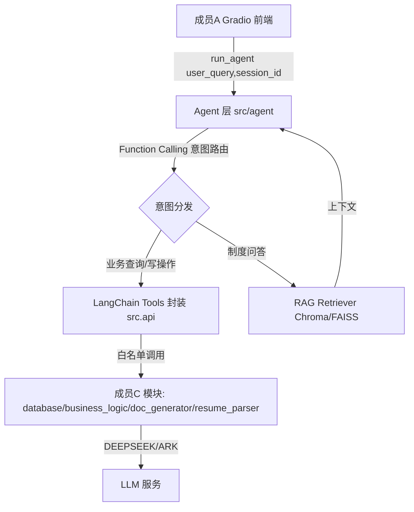

## 用户需求

作为成员B（Agent/RAG 核心开发），接收成员C（后端数据与文档处理）已完成的交接，并继续完成 Agent 核心开发。需输出一份详细的后续工作计划与交接流程，覆盖以下四点，并确保项目平滑过渡、后续接口无冲突。

## 一、成员C已完成模块与功能清单

- **数据库与数据**：SQLite 五张核心表（employees/attendance/leave_requests/payroll/recruitment），含外键 employee_code，已预置 183 条逻辑自洽模拟数据。
- **统一对外接口 `src/api.py`**：导出 24 个函数（见接口清单），含员工/考勤/请假/薪酬/招聘查询、个税/社保/年假/工作日/薪酬汇总计算、简历解析、文档生成、项目初始化与看板概览。
- **简历解析 `resume_parser.py`**：PDF/Word 文本提取 + DeepSeek LLM 结构化抽取（Pydantic ResumeInfo）。
- **文档生成 `doc_generator.py`**：入职材料清单、离职交接清单、录用通知书 Word 生成。
- **便捷函数**：`setup_project()`、`get_dashboard_summary()`。

## 二、需交接接口及边界（严格区分不可混用/易串用）

1. **唯一入口边界**：所有调用必须从 `src.api` 导入，禁止直接调用 `database.py`/`business_logic.py`/`resume_parser.py`/`doc_generator.py` 内部函数；`api.py` 的 `__all__` 为白名单。
2. **`calculate_tax` vs `calculate_monthly_tax`**：前者累计预扣法（需 cumulative_income/cumulative_tax_paid/month_number），后者单月估算（等价于累计为0、月序号1）；返回格式一致但语义不同，不可混用。
3. **`parse_resume`(file_path,对外,返回{success,data,error}) vs `parse_resume_text`(resume_text,内部,失败返回非标准{_raw_response,_error})**：成员B/成员A 只能调 `parse_resume`。
4. **`calculate_salary_summary(payroll_records)`**：输入是 `query_payroll` 的结果 list[dict]，不是 employee_code，须先查询再喂入。
5. **枚举字符串须严格一字不差**（Tools docstring 写死）：leave_type=年假/事假/病假/婚假/产假/调休；recruitment.status=简历筛选/初试/复试/终试/已发Offer/已入职/已拒绝；employees.status=在职/离职/试用期；attendance.status=正常/迟到/早退/缺勤/请假。
6. **关联键 `employee_code`(字符串 EMP001) vs 主键 `id`(int)**：除 `update_recruitment_status(recruitment_id: int, ...)` 用 recruitment 自增 id 外，其余 api 统一用 employee_code。
7. **写操作有副作用**：submit_leave、update_employee、insert_recruitment、update_recruitment_status、generate_* 须防 Agent 误触发。
8. **破坏性操作**：`python data/seed_data.py` 会删除重建库；`setup_project` 会初始化库，执行前须备份。

## 三、API Key 配置规范

- **DeepSeek（已实现）**：`.env` 配置 `DEEPSEEK_API_KEY`、`DEEPSEEK_BASE_URL`(默认 https://api.deepseek.com)、`DEEPSEEK_MODEL`(默认 deepseek-chat)；用于简历解析及成员B的 Agent/RAG 大模型调用。
- **火山方舟（待开发项，成员B接管后补充）**：在 `.env.example` 增加 `ARK_API_KEY`/`ARK_BASE_URL`(OpenAI 兼容 endpoint)/`ARK_MODEL`(如 doubao 模型)，并在 `resume_parser.get_llm_client()` 增加 provider 分支（DEEPSEEK/ARK 二选一，建议用 `LLM_PROVIDER` 环境变量切换）。适用场景：DeepSeek 配额耗尽或并发受限时降级，或用于对比豆包等模型效果。安全：`.env` 不入库、不发送给组员。

## 四、代码与文档交接步骤

1. 成员C交付 `.env`（仅口头/私发 Key，不入库）+ 交接书.md + 全部源码与 data/hr_agent.db。
2. 成员B复制 `.env.example` 为 `.env` 填 Key，执行 `pip install -r requirements.txt` 验证可导入 `from src.api import *`。
3. 成员B运行冒烟测试：调用各查询类 api 验证返回结构与枚举一致性，确认 `data/hr_agent.db` 可用。
4. 签署交接确认，冻结 `src.api` 接口签名（后续如需变更走契约评审）。

## 五、成员B后续开发范围

- 新建 `src/agent/` 模块（与C模块解耦、互不修改）。
- 将 `src.api` 函数封装为 LangChain Tool（枚举写死、写操作防护）。
- 7 类意图路由（招聘咨询/考勤/薪酬/请假/入职/离职/制度问答）+ RAG 制度知识库。
- 实现 `run_agent(user_query, session_id) -> dict` 供成员A接入 Gradio。
- 完成火山方舟适配改造。

## 技术栈

- 语言：Python 3.11
- Agent 框架：LangChain（`langchain_openai.ChatOpenAI`、`langchain.tools.tool`、RouterChain / Function Calling）
- 向量库：Chroma 或 FAISS（RAG 检索）
- 复用成员C现有模块：`src.api`（唯一入口）、`src.resume_schema`（Pydantic）、`src.resume_parser`（LLM 客户端）

## 实现方案

采用**分层解耦**策略：成员B在 `src/agent/` 下新建 Agent 层，仅通过 `src.api` 白名单调用成员C能力，绝不修改 `src.api`/`database.py`/`business_logic.py` 内部逻辑，避免接口冲突。

**关键决策：**

1. **Tools 封装**：每个 `src.api` 函数包成 `@tool`，docstring 中写死枚举值与参数说明；写操作（submit_leave 等）在 tool 描述中显式标注"有副作用、需用户确认"，降低误触发。
2. **意图路由**：优先采用 LLM Function Calling 一次性分发到具体 Tool，7 类意图对应工具组；制度问答走 RAG Retriever，避免多轮 RouterChain 的额外延迟。
3. **LLM 客户端单例**：复用 `resume_parser.get_llm_client()` 单例模式，新增 provider 分支（DEEPSEEK/ARK），通过 `LLM_PROVIDER` 切换，避免重复建连与 Key 泄漏。
4. **RAG**：加载《员工手册》《考勤管理制度》《个税计算规则》等，用 LangChain Document Loaders + Text Splitters 切块，存入 Chroma/FAISS，检索结果作为上下文注入。

**性能与可靠性**：Tools 调用均为本地 SQLite 查询（O(log n) 索引命中），无网络瓶颈；LLM 调用为热点，须复用单例客户端并设 `temperature=0.1`（解析）以保证稳定；RAG 检索用向量近似搜索，避免全量扫描。`run_agent` 返回固定 dict 契约，便于成员A流式接入。

## 实现要点

- 严禁改 `src.api` 签名/白名单；新增导出须在成员B模块内做二次封装。
- `.env` 与 `data/hr_agent.db` 已配 `.gitignore`，Key 不入库。
- 火山方舟改造仅限 `resume_parser.py` 与 `.env.example`，保持 `DEEPSEEK_*` 默认路径不变（向后兼容）。

## 架构设计



## 目录结构

```
HR-agent/
├── 成员B接管计划与接口对接手册.md   # [NEW] 交接文档：C完成清单、接口边界标注、API Key规范、交接步骤
├── requirements.txt                 # [MODIFY] 补充 langchain/langchain-openai/chromadb(或faiss-cpu)/tiktoken 等B侧依赖
├── .env.example                     # [MODIFY] 增加 ARK_API_KEY/ARK_BASE_URL/ARK_MODEL 与 LLM_PROVIDER 配置
├── src/
│   ├── resume_parser.py             # [MODIFY] get_llm_client 增加 provider 分支(DEEPSEEK/ARK 二选一)
│   └── agent/                       # [NEW] 成员B Agent 层包（与C模块解耦）
│       ├── __init__.py              # [NEW] 包导出
│       ├── tools.py                 # [NEW] 将 src.api 函数封装为 LangChain Tool（枚举写死、写操作防护）
│       ├── rag.py                   # [NEW] 加载制度文档、切块、构建 Chroma/FAISS 向量库与检索器
│       ├── router.py                # [NEW] 7类意图定义与路由逻辑
│       └── agent.py                 # [NEW] Agent 主流程，提供 run_agent(user_query,session_id)->dict 入口
```

## 关键代码结构

```python
# src/agent/agent.py —— 与成员A的对接契约（来自三人分工.md，保持签名不变）
def run_agent(user_query: str, session_id: str) -> dict:
    # 返回: {"response": str, "tool_used": str, "data": dict|None}
    ...

# src/resume_parser.py —— 火山方舟适配（在现有单例内增加 provider 切换）
def get_llm_client():
    provider = os.environ.get("LLM_PROVIDER", "deepseek").lower()
    if provider == "ark":
        api_key = os.environ.get("ARK_API_KEY")
        base_url = os.environ.get("ARK_BASE_URL")
        model = os.environ.get("ARK_MODEL")
    else:
        api_key = os.environ.get("DEEPSEEK_API_KEY")
        base_url = os.environ.get("DEEPSEEK_BASE_URL", "https://api.deepseek.com")
        model = os.environ.get("DEEPSEEK_MODEL", "deepseek-chat")
    ...
```